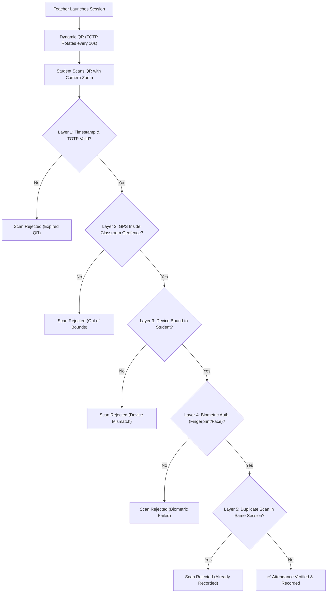

# 🎓 CCSA Attendance System

> **Production-grade, Anti-Proxy Smart Attendance System** designed for the **Centre for Computer Science and Applications (CCSA), Dibrugarh University**. Built with Flutter Material 3, inspired by modern fintech UX (Google Pay design philosophy), featuring 5-layer anti-fraud verification and adaptive multi-platform support (Android, iOS, Windows, Web).

[](https://flutter.dev)
[](https://dart.dev)
[](https://m3.material.io)
[](#multi-platform-architecture)
[](LICENSE)

---

## 🌟 Key Highlights

- 🛡️ **5-Layer Anti-Proxy & Anti-Fraud Security**: Eliminates proxy attendance, buddy punching, and QR screenshot forwarding.
- ⏱️ **Dynamic TOTP Rotating QR**: Session QR updates in real-time with millisecond-precision SHA-256 HMAC encryption.
- 📍 **Classroom GPS Geofencing**: Intelligent dual-accuracy location verification with indoor concrete building tolerance (+30m).
- 📱 **Hardware Device Binding**: 1-Student = 1-Hardware Device lock to prevent multi-account scanning from a single phone.
- 🔍 **Desk-Friendly Camera Zoom**: In-app digital & optical zoom (1x, 2x, 3x, Max + slider) allows back-bench students to scan projector screens effortlessly.
- 📊 **NEP 2020 Compliance Engine**: Live status categories conforming to Dibrugarh University examination standards:
  - **Regular**: $\ge 80\%$ attendance
  - **Non-Collegiate (NC)**: $70\% - 79.9\%$
  - **Dis-Collegiate (DC)**: $< 70\%$
- 📁 **DU Examination Export**: One-click standardized CSV exports pre-formatted for Dibrugarh University Controller of Examinations.

---

## 📐 5-Layer Anti-Proxy Architecture



1. **Layer 1: Dynamic TOTP QR Codes** — Rotates automatically every 10 seconds. Static photos or shared screenshots expire before they can be forwarded.
2. **Layer 2: GPS Geofencing** — Verifies student coordinates against lecture hall latitude/longitude.
3. **Layer 3: Hardware Device Binding** — Unique device identifiers ensure students cannot sign in to peers' accounts on their phone.
4. **Layer 4: Biometric Prompt** — Local biometric authentication (Fingerprint / Face ID / System Passcode) confirms physical presence.
5. **Layer 5: Session Idempotency & PIN Fallback** — Prevents multiple scans per student per lecture. Includes rolling emergency PIN for low-camera lighting conditions.

---

## 📱 User Roles & Capabilities

### 👨‍🏫 Faculty Portal
- **Dashboard & Subject Hub**: Manage BCA, MCA, and PGDCA courses across Semesters 1 to 8 with batch segmentation (Whole Class, Lab Group A/B).
- **Live Dynamic QR Broadcaster**: Fullscreen high-visibility QR display optimized for classroom projectors.
- **Real-Time Attendance Feed**: Live counter showing turnout and attending students as they scan.
- **Session Logs & History**: Complete audit trail of past lectures, total strength, and attendance rates.
- **Dibrugarh University CSV Export**: Instant generation of official attendance sheets ready for university submission.
- **Historical Attendance Import**: Intelligent CSV ingestion with automatic column matching.

### 🧑‍🎓 Student Portal
- **Real-Time Dashboard**: Clean visualization of overall NEP compliance gauge and subject-wise attendance bars.
- **Fast Scanner with Zoom**: Integrated scanner with 1x, 2x, 3x presets and slider to scan from anywhere in the classroom.
- **Attendance History Log**: Filterable log (All, Present, Absent) with search by subject code/name.
- **Academic Profile Management**: Setup program (BCA/MCA/PGDCA), semester (1–8), Class Roll Number, and DU Registration Number.
- **Account Security**: Change Password and Change Email flows protected with current credential verification.

---

## 🎨 UI/UX Design Philosophy

Designed under **Google Pay & Material Design 3 (M3)** principles:
- **Zero Overflow & Marquee Text**: Critical titles, banners, and headers employ auto-scrolling marquee tickers to guarantee text never gets clipped (`...`).
- **Comfort Tone Palette**: Warm slate `#F1F5F9` surfaces replacing harsh stark-white backgrounds.
- **Adaptive Universal Layout**:
  - **Mobile (<600px)**: Bottom navigation bar, full-width cards, touch-optimized ergonomics.
  - **Tablet / Desktop (>600px)**: Persistent Navigation Rail / Drawer, constrained max-width containers (`1200px`) preventing awkward stretching.

---

## 🛠️ Tech Stack & Dependencies

| Layer | Technology |
|---|---|
| **Framework** | [Flutter](https://flutter.dev) (v3.x) with Null Safety |
| **Language** | [Dart](https://dart.dev) (v3.x) |
| **Design System** | Material 3, Google Fonts (Plus Jakarta Sans, Inter), Lucide Icons |
| **Local Database** | `sqflite` (Android/iOS) & `sqflite_common_ffi` (Desktop) |
| **Camera & QR** | `mobile_scanner`, `qr_flutter` |
| **Security & Hardware** | `local_auth` (Biometrics), `device_info_plus`, `crypto` (HMAC SHA-256) |
| **Geolocation** | `geolocator` |
| **Data Export** | `csv`, `intl`, `path_provider`, `share_plus` |

---

## 🚀 Getting Started

### Prerequisites
- [Flutter SDK](https://docs.flutter.dev/get-started/install) (`>= 3.3.0`)
- Android Studio / VS Code with Flutter extension
- Connected Android/iOS physical device or emulator

### Installation

1. **Clone the repository:**
   ```bash
   git clone https://github.com/chenkham/ccsa-attendance.git
   cd ccsa-attendance
   ```

2. **Install Flutter packages:**
   ```bash
   flutter pub get
   ```

3. **Verify codebase health:**
   ```bash
   flutter analyze
   ```

4. **Run on connected device:**
   ```bash
   # Run on default connected phone/emulator
   flutter run

   # Or run specific target
   flutter run -d android
   flutter run -d windows
   ```

5. **Build Release APK:**
   ```bash
   flutter build apk --release
   ```
   Output will be generated at `build/app/outputs/flutter-apk/app-release.apk`.

---

## 📂 Project Architecture

```
lib/
├── db/                     # SQLite schema, migrations & CRUD operations
│   └── database_helper.dart
├── models/                 # Strongly typed data models
│   ├── attendance_session.dart
│   ├── student.dart
│   ├── subject.dart
│   └── user.dart
├── pages/                  # Screen modules
│   ├── auth/               # Login, Sign Up, Password Reset
│   ├── common/             # Settings, Profile & Security
│   ├── faculty/            # Faculty Dashboard, Create Subject, Dynamic QR
│   ├── profile/            # Academic Profile (Roll No, Course, Sem)
│   └── student/            # Student Dashboard, QR Scanner, History
├── services/               # Core application logic & hardware APIs
│   ├── api_service.dart
│   ├── auth_service.dart
│   ├── csv_export_service.dart
│   ├── device_security_service.dart
│   ├── location_service.dart
│   └── totp_qr_service.dart
├── theme/                  # Material 3 typography, colors & shadow presets
│   └── app_theme.dart
├── widgets/                # Reusable UI components & animations
│   ├── attendance_chart.dart
│   ├── attendance_gauge.dart
│   ├── custom_cards.dart
│   ├── marquee_text.dart
│   └── responsive_layout.dart
└── main.dart               # App entrypoint & routing setup
```

---

## 🔒 Security & Privacy

- **No Remote Secrets Stored**: Passwords and cryptographic seeds are salted, hashed, and stored locally within device sandboxes.
- **No Background Location Tracking**: Geolocation permissions are requested solely during active QR scan verification.
- **Biometric Passcode Fallback**: Uses standard Android BiometricPrompt and iOS LocalAuthentication APIs; raw biometric templates are never accessed or stored by the app.

---

## 📄 License

This project is licensed under the MIT License - see the [LICENSE](LICENSE) file for details.

---

*Developed for the Centre for Computer Science and Applications (CCSA), Dibrugarh University.*
